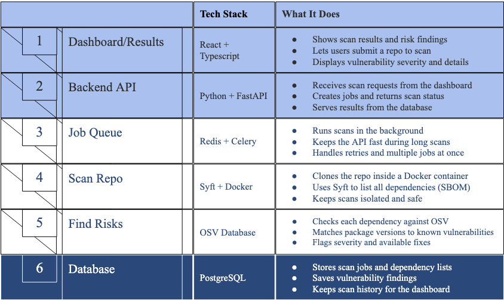

# Banana Chain: Supply Chain Risk Detector

## What it does

Banana Chain is a supply chain risk detector. You give it a public GitHub repo or upload your project files, and it lists every package your project depends on.

## Pipeline overview



1. **Dashboard/Results:** users submit a repo and see the results.
2. **Backend API:** FastAPI receives scan requests and serves results.
3. **Job Queue:** Redis and Celery run scans in the background.
4. **Scan Repo:** Syft lists all dependencies (the SBOM) in an isolated Docker container.
5. **Find Risks:** each dependency is checked against the OSV database.
6. **Database:** PostgreSQL stores scans, dependency lists, and findings.

## Tech stack

- Python, FastAPI, Jinja2
- Syft (SBOM generation, CycloneDX format)
- PostgreSQL, SQLAlchemy, Alembic
- Docker Compose

## Quickstart

TODO: fill in after setup is finalized.

```bash
# TODO: install dependencies
# TODO: start the database
# TODO: run migrations
# TODO: start the app
```

## Project structure

```
app.py             FastAPI routes (home page and /results)
run_syft.py        Runs Syft and returns the SBOM as JSON
requirements.txt   Python dependencies
templates/
  main.html        Upload form
  results.html     Results table and SBOM download
docs/
  images/          README images (pipeline-overview.png)
README.md
```

## Contributing

See [CONTRIBUTING.md](CONTRIBUTING.md).

## License

TODO: choose a license 