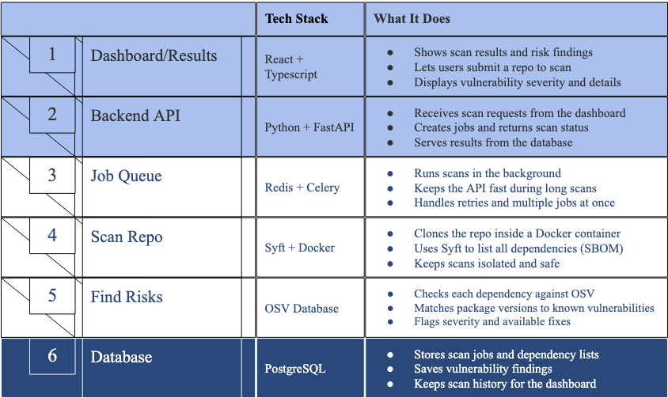

# Banana Chain: Supply Chain Risk Detector

## What it does

Banana Chain is a supply chain risk detector. You give it a public GitHub repo or upload your project files, and it lists every package your project depends on.

## Pipeline overview



1. **Dashboard/Results:** users submit a repo and see the results.
2. **Backend API:** FastAPI receives scan requests and serves results.
3. **Job Queue:** Redis and Celery run scans in the background.
4. **Scan Repo:** Syft lists all dependencies (the SBOM) in an isolated Docker container.
5. **Find Risks:** each dependency is checked against the OSV database.
6. **Database:** PostgreSQL stores scans, dependency lists, and findings.

## Tech stack

- Python, FastAPI, Jinja2
- Syft (SBOM generation, CycloneDX format)
- PostgreSQL, SQLAlchemy, Alembic
- Docker Compose

# Quickstart

## Vulnerability Scanning (Syft + Grype)

The backend runs [Syft](https://github.com/anchore/syft) to build an SBOM, then
[Grype](https://github.com/anchore/grype) to match every package against known
vulnerabilities. Both need to be installed and on your PATH before you start the backend.

**Versions we use:** Syft `<version>`, Grype `<version>` (check yours with the commands below).

### Install

**Windows**
1. Download the Windows `.zip` for each tool from its GitHub releases page
   (`anchore/syft` and `anchore/grype`).
2. Unzip, and put `syft.exe` and `grype.exe` in a folder on your PATH (for example `C:\tools`).
3. Open a **new** terminal so the PATH change shows up.

Double-clicking the `.exe` files just flashes a window. They're command-line tools,
so run them from a terminal.

**WSL / Linux / Mac**
```bash
curl -sSfL https://raw.githubusercontent.com/anchore/syft/main/install.sh | sudo sh -s -- -b /usr/local/bin
curl -sSfL https://raw.githubusercontent.com/anchore/grype/main/install.sh | sudo sh -s -- -b /usr/local/bin
```
On a Mac with Homebrew, `brew install syft grype` also works.

### Check It Works

```bash
syft --version
grype --version
grype db update
```

`grype db update` downloads the vulnerability database. Do this once up front,
otherwise your first scan will sit there while it downloads.

### Run the App

Backend, from the repo root (not from inside `app/`):
```bash
pip install -r requirements.txt
uvicorn app.main:app --port 5000
```

Frontend, in a second terminal:
```bash
cd frontend
npm install
npm run dev
```

## Project structure

```
app.py             FastAPI routes (home page and /results)
run_syft.py        Runs Syft and returns the SBOM as JSON
requirements.txt   Python dependencies
templates/
  main.html        Upload form
  results.html     Results table and SBOM download
docs/
  images/          README images (pipeline-overview.png)
README.md
```

## Contributing

See [CONTRIBUTING.md](.github/CONTRIBUTING.md).

## License

TODO: choose a license 