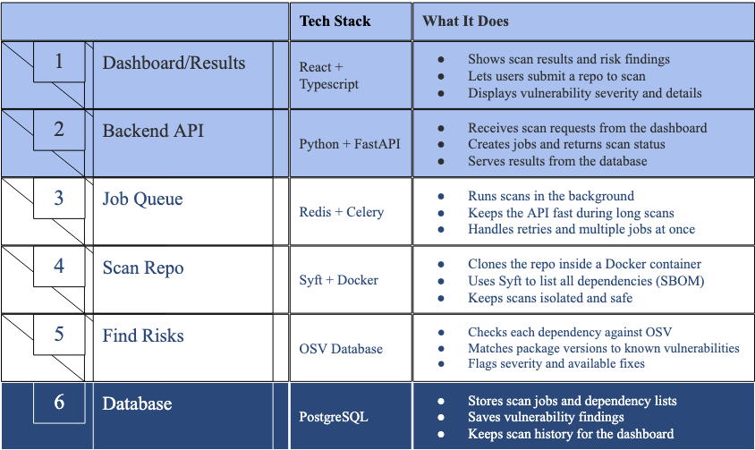

# Banana Chain: Supply Chain Risk Detector

## What it does

Banana Chain is a supply chain risk detector. You give it a public GitHub repo or upload your project files, and it lists every package your project depends on.

## Pipeline overview



1. **Dashboard/Results:** users submit a repo and see the results.
2. **Backend API:** FastAPI receives scan requests and serves results.
3. **Job Queue:** Redis and Celery run scans in the background.
4. **Scan Repo:** Syft lists all dependencies (the SBOM) in an isolated Docker container.
5. **Find Risks:** each dependency is checked against the OSV database.
6. **Database:** PostgreSQL stores scans, dependency lists, and findings.

## Tech Stack

**Implemented:**

- Python, FastAPI, Jinja2
- Pydantic
- Syft (CycloneDX 1.7 SBOM generation)
- PostgreSQL, SQLAlchemy
- Docker Compose
- pytest

**Planned/In Development:**

- Redis and Celery for background processing
- OSV API for vulnerability detection
- Alembic for database migrations

## Quickstart

### Prerequisites

- Python 3.12 or newer
- Syft installed and available on your PATH
- Docker Desktop

### Installation

Install the project dependencies:

```powershell
python -m pip install -r requirements.txt
```

Create your local environment configuration:

```powershell
Copy-Item .env.example .env
```

Update the PostgreSQL password and connection settings in `.env`.

Start PostgreSQL:

```powershell
docker compose up -d postgres
```

Initialize the database:

```powershell
python -m app.db.init_db
```

Start the FastAPI application:

```powershell
python -m uvicorn app:app --host 127.0.0.1 --port 5001
```

Open http://127.0.0.1:5001 in your browser.

For additional database configuration and testing instructions, see [Local Database Setup](#local-database-setup).

## Project Structure

```text
app/
  main.py                 FastAPI routes and application
  schemas/                Shared Pydantic models
  db/
    database.py            Database connection configuration
    models.py              SQLAlchemy database models
    init_db.py             Database initialization
    verify_persistence.py  PostgreSQL persistence verification
  services/
    sbom.py                SBOM and component persistence

services/
  cyclonedx.py             CycloneDX validation and normalization
  schemas/                 CycloneDX JSON schemas

tests/
  fixtures/                Sanitized SBOM test fixtures
  test_cyclonedx.py        CycloneDX validation and normalization tests
  test_schemas.py          Pydantic schema tests
  test_sbom_persistence.py Database persistence tests
  test_app_integration.py  FastAPI integration tests

templates/
  main.html                Upload form
  results.html             Results table and SBOM download

app.py                     Application compatibility entry point
run_syft.py                Syft SBOM generation
requirements.txt           Runtime dependencies
requirements-dev.txt       Testing dependencies
docker-compose.yml         PostgreSQL and Redis configuration
.env.example               Example environment configuration
README.md                  Project documentation
```

## Contributing

See [CONTRIBUTING.md](.github/CONTRIBUTING.md).

## License

TODO: choose a license

## Local Database Setup

Banana Chain uses PostgreSQL to store raw CycloneDX SBOM documents and their normalized components.

### Prerequisites

- Python with a virtual environment
- Docker Desktop with the Linux container engine running
- Project dependencies installed

Install dependencies:

```powershell
python -m pip install -r requirements.txt
python -m pip install -r requirements-dev.txt
```

### 1. Configure Environment Variables

Copy the example environment file:

```powershell
Copy-Item .env.example .env
```

Open `.env` and replace the placeholder PostgreSQL password with your own password.

Make sure `POSTGRES_PASSWORD` and the password in `DATABASE_URL` match.

Do not commit `.env` because it contains local database credentials.

### 2. Configure the PostgreSQL Port

By default, PostgreSQL uses port `5432`.

If another PostgreSQL installation is already using that port, you can change the host port in `.env`:

```dotenv
POSTGRES_PORT=55432
```

Update `DATABASE_URL` to use the same port:

```text
postgresql://sbom_user:<your-password>@127.0.0.1:55432/sbom_db
```

The `POSTGRES_PORT` value controls the port exposed on your computer. PostgreSQL continues using port `5432` inside its Docker container.

### 3. Start PostgreSQL

Start Docker Desktop, then run:

```powershell
docker compose up -d postgres
```

Verify the container is running:

```powershell
docker compose ps
```

Wait until `sbom-postgres` reports a healthy status.

### 4. Initialize Database Tables

Run:

```powershell
python -m app.db.init_db
```

Expected output:

```text
Database tables initialized.
Tables: ['components', 'sboms']
```

The database contains two tables:

- `sboms`: Stores the original CycloneDX document for each scan.
- `components`: Stores normalized components associated with each SBOM.

The initialization command creates missing tables without deleting existing data.

### 5. Run Automated Tests

Run:

```powershell
python -m pytest -q
```

The test suite covers CycloneDX validation, normalization, Pydantic schemas, and database persistence.

### 6. Verify PostgreSQL Persistence (Optional)

To test the persistence service against PostgreSQL, run:

```powershell
python -m app.db.verify_persistence
```

This test:

- Loads a sanitized real-world CycloneDX fixture.
- Saves the original SBOM and normalized components.
- Verifies that repeated saves do not create duplicates.
- Checks that the stored component counts are correct.
- Removes the temporary test records when finished.

### Notes

- PostgreSQL data is stored in a persistent Docker volume.
- Redis is configured separately and is not required for SBOM persistence testing.
- The `save_sbom()` service is implemented and tested, but automatic persistence from the FastAPI scanning route is not yet connected.
- The current initialization utility is intended for development. Versioned database migrations should be introduced as the schema evolves.
